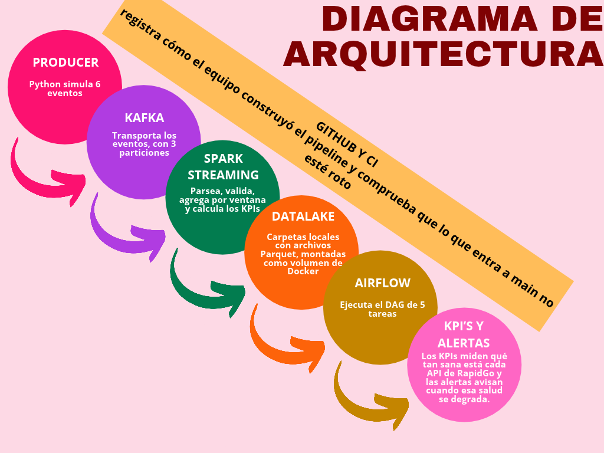

# RapidGo 360 - Observabilidad tecnológica

## 1. Nombre del proyecto, variante 9 y miembros del equipo

Proyecto final de Big Data de la Universidad de Cundinamarca, variante 9: observabilidad tecnológica.

Equipo:
- Sebastian Valencia
- Camilo Soler
- Javier Prieto

## 2. Problema de negocio y valor de la solución

RapidGo necesita detectar degradaciones de sus servicios antes de que afecten de forma visible la operación del negocio. En la práctica, las APIs pueden elevar tiempos de respuesta y tasas de error sin que la operación central lo vea a tiempo.

La solución propone emitir eventos de observabilidad, publicar los eventos en Kafka, procesarlos con Spark Structured Streaming y materializar indicadores por ventana y servicio en el Data Lake. El valor real del proyecto es convertir eventos técnicos en decisiones operativas: detectar picos de error, p95 de latencia y disponibilidad por servicio en ventanas de 1 minuto.

## 3. Arquitectura



Flujo textual:

```text
Producer / samples -> Kafka (topic rapidgo.observability.events, key=service) -> Spark Structured Streaming -> Data Lake (raw / processed / curated) -> Airflow -> alertas e indicadores
```

Este repo documenta la arquitectura real de la etapa actual: producer, Kafka, Spark y Data Lake, con Airflow como orquestador del pipeline y la validación de la intención operativa.

## 4. Tecnologías y rol de cada una

| Tecnología | Versión real en repo | Rol |
|---|---|---|
| Kafka | `apache/kafka:3.9.0` en `docker-compose.yml` | Broker de eventos en modo KRaft |
| Spark | `apache/spark:3.5.3` y `pyspark==3.5.3` | Procesamiento en streaming y parquet |
| Airflow | `rapidgo-airflow:2.10.5` en `docker-compose.yml` | Orquestación del DAG y validación de ejecución |
| Python | 3.12 en `producer/Dockerfile`; CI también prueba 3.13 | Base del producer, tests y reglas de negocio |
| Pytest | Requerido en `requirements.txt` y ejecutado en CI | Validación del contrato y reglas |
| GitHub Actions | `.github/workflows/ci.yml` | CI con compileall, pytest y `docker compose config --quiet` |

Airflow se construye desde [airflow/Dockerfile](airflow/Dockerfile), basado en `apache/airflow:2.10.5`.

## 5. Prerrequisitos y ejecución local

Sigue la [guía de ejecución local](docs/ejecucion-local.md). Los pasos principales son:

```text
docker compose up -d --build
```

Espera aproximadamente 4 minutos para que Spark cierre ventanas con el watermark y genere `curated`. Después ejecuta:

```text
python scripts/smoke_test.py
```

El script verifica contenedores, topic y particiones Kafka, Parquet reciente en las tres capas, Airflow, el DAG y el reporte. Debe terminar con `RESULTADO: pipeline completo funcionando`.

Airflow:
- URL: [http://localhost:8080](http://localhost:8080)
- Usuario: `admin`
- Contraseña (comando de [docs/ejecucion-local.md](docs/ejecucion-local.md)):

```text
docker compose exec airflow cat /opt/airflow/standalone_admin_password.txt
```

El DAG publica el reporte en `datalake/reports/latest.md`.

Para empezar de cero, ejecuta `docker compose down` y elimina dentro de `datalake/` las carpetas `raw`, `processed`, `curated`, `reports` y `_checkpoints`; conserva `datalake/README.md`. Los checkpoints de Spark persisten tras `down`, así que no reutilices una ejecución anterior como si fuera limpia.

## 6. Topic, key, particiones, eventos, KPIs y reglas

El topic real del proyecto es:
- `rapidgo.observability.events`
- Key: `service`
- Particiones: 3
- Retención: 24h (`retention.ms=86400000`)
- Configuración en `docker-compose.yml` y `docs/decisions/ADR-001-key-particiones.md`

Cada evento sigue el contrato documentado en [docs/contrato.md](docs/contrato.md) y usa campos como:
- `event_id`, `timestamp`, `service`, `endpoint`, `http_method`, `http_status`, `latency_ms`, `region`

KPIs reales y reglas del repo:
- Error rate > 5 %
- p95 > 1000 ms
- mínimo 20 eventos por ventana
- ventana de 1 minuto
- watermark de 2 minutos

Estas reglas están consistentes entre `spark/config.py`, `spark/rules.py` y la documentación actual, con `window(event_time, "1 minute")` y `groupBy(..., "service")` en `spark/streaming_job.py`.

## 7. Cómo ejecutar pruebas y GitHub Actions

Pruebas locales:

```bash
python -m pytest -v
```

La validación de CI está definida en [.github/workflows/ci.yml](.github/workflows/ci.yml) y ejecuta:
- Job `test`: Python 3.13 con Airflow 3.1.3, dependencias del repo, `compileall`, `pytest -v` y `docker compose config --quiet`.
- Job `dag`: Python 3.12 con Airflow 2.10.5 y `pytest -v tests/test_dag_integrity.py`.

Para disparar el workflow manualmente:
- GitHub -> `Actions` -> `CI` -> `Run workflow`

## 8. Cómo acceder a Airflow y ejecutar el DAG

El DAG `rapidgo_observability_pipeline` contiene seis tareas: `check_sources` precede a `quality_check`, `partition_distribution` y `aggregate_kpis`; `aggregate_kpis` precede a `evaluate_alerts`; `publish_report` recibe los resultados de las cinco tareas anteriores. Los retornos se pasan mediante XCom. La configuración común es `retries=2` y `retry_delay=30 s`; el DAG corre cada 10 minutos y también se puede lanzar con **Trigger DAG**.

El fallo controlado se produjo cuando faltaban las capas Parquet; las tareas posteriores quedaron `upstream_failed` y no se publicó un reporte parcial. Tras restablecer producer/Spark y ejecutar de nuevo, las seis tareas finalizaron en `success`. Consulta [checkpoint Semana 3](docs/checkpoints/semana3.md) y [ADR-003](docs/decisions/ADR-003-orquestacion-y-recuperacion.md).

## 9. Resultados y evidencias representativas

Evidencia del reporte de [11 de noviembre de 2026](docs/evidencia/latest_semana4.md):

- Calidad en `processed`: 11.191 filas, 0 fuera de contrato y 0 `event_id` repetidos.
- Se registraron 8 alertas: 4 de tasa de error y 4 de latencia crítica. Entre los ejemplos del reporte: `tracking-api` tuvo p95 de 1749 ms y tasa de error 0,3158; `notifications-api` tuvo p95 de 1780 ms y tasa de error 0,3158.
- Reparto Parquet por partición: p0=3318 (29,6 %), p1=6780 (60,6 %), p2=1093 (9,8 %).
- El [smoke test de Semana 4](docs/evidencia/smoke_test_semana4.txt) reporta topic con 3 particiones, offsets `{0: 6326, 1: 12937, 2: 2175}` (total 21438), capas recientes, Airflow respondiendo, las 6 tareas en `success` y reporte generado.
- El [grafo del DAG](docs/evidencia/airflow_grafo_semana4.png) muestra la orquestación.

Son ejecuciones diferentes: los offsets y conteos del smoke test no deben mezclarse con los conteos de la tabla del reporte.

## 10. Decisiones y documentación

- [docs/decisions/ADR-001-key-particiones.md](docs/decisions/ADR-001-key-particiones.md)
- [docs/decisions/ADR-002-umbrales-y-sinks.md](docs/decisions/ADR-002-umbrales-y-sinks.md)
- [docs/decisions/ADR-003-orquestacion-y-recuperacion.md](docs/decisions/ADR-003-orquestacion-y-recuperacion.md)
- [docs/checkpoints/semana1.md](docs/checkpoints/semana1.md)
- [docs/checkpoints/semana2.md](docs/checkpoints/semana2.md)
- [docs/checkpoints/semana3.md](docs/checkpoints/semana3.md)
- [docs/contrato.md](docs/contrato.md)
- [docs/kpis-alertas.md](docs/kpis-alertas.md)
- [docs/ejecucion-local.md](docs/ejecucion-local.md)
- [docs/release-notes-v1.0.0.md](docs/release-notes-v1.0.0.md)

## 11. Limitaciones conocidas y trabajo futuro

- p95 calculado por servicio y no por endpoint; la agregación actual no presenta p95 por endpoint.
- La key `service` conserva la afinidad por servicio, pero el reparto observado en el reporte de Semana 4 está desbalanceado: p1 concentra 60,6 %.
- Airflow se ejecuta en modo `standalone` local; no es una configuración de producción.
- El producer genera datos sintéticos.
- CI prueba compatibilidad del DAG con Airflow 3.1.3/Python 3.13 y Airflow 2.10.5/Python 3.12; Docker ejecuta Airflow 2.10.5.
- Los checkpoints de Spark persisten tras `docker compose down`; para empezar de cero hay que borrar los datos y checkpoints como indica la guía.
- La lógica de reglas también existe en `spark/rules.py`, `spark/config.py` y `airflow/dags/rapidgo_checks.py`; cambios de umbrales deben mantenerlas alineadas.
- `curated` no publica una ventana hasta que el watermark de 2 minutos la cierra.

## 12. Tabla de contribuciones

| Integrante | Responsabilidades | Issues | PR principales |
|---|---|---|---|
| Sebastian Valencia (`smithvza`, confirmado por el equipo) | Contrato JSON, producer, diagrama, Docker Compose, CI ampliado, quality gate y release | #6, #12 | #22, #23, #24, #30, #32 |
| Camilo Soler (`CamilosolerB`) | Docs, Kanban, KPIs/alertas, tests/CI, fallo controlado, checkpoint Semana 3, README y video | #5, #7, #16, #17 | #26, #27, #28, #29, #34, #35, #37 |
| Javier Prieto (`nagi24118`, confirmado por el equipo) | Repositorio/infraestructura, Kafka/ADR-001, DAG e integración/estabilización | #8, #15 | #25, #31, #33, #36 |

Cuentas observadas en el historial de git:
- `CamilosolerB`
- `nagi24118`
- `smithvza`

Los números anteriores se verificaron en issues/PR del repositorio, y las tres cuentas se confirmaron con el equipo. Los issues se relacionan por alcance según la planeación, no por asignación de GitHub. La planeación asigna el producer a Sebastian, aunque el PR #31 figura en GitHub como abierto por `nagi24118` (Javier); la columna de PR registra la cuenta autora, no reasigna la responsabilidad planeada.

## 13. Video final

PENDIENTE: enlace al video.

El release `v1.0.0` está preparado en [las notas de release](docs/release-notes-v1.0.0.md), pero el tag aún no existe y no debe anunciarse como publicado hasta que se cumplan las precondiciones del equipo.

---

Este README se mantiene alineado con la evidencia real del repo: lo verificado está documentado, y lo no verificado queda claramente marcado como `PENDIENTE`.
